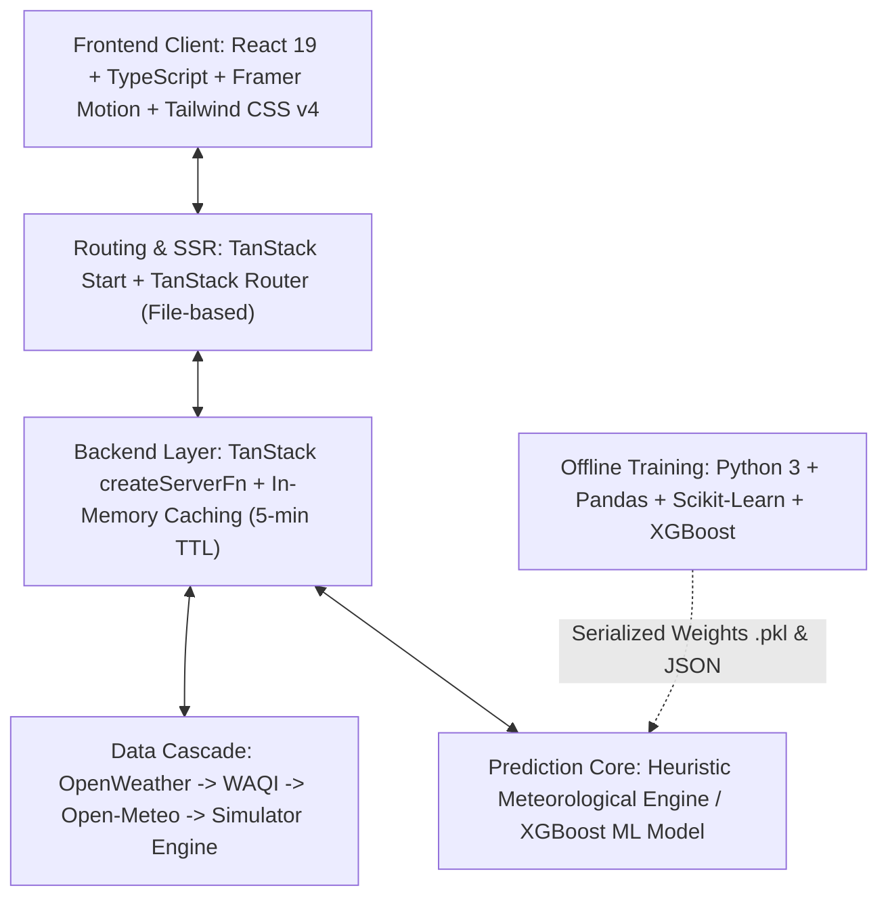

# Air Quality Predictor (Kerala) — Full Implementation Plan
**System Architecture, Machine Learning Regression, Data Engineering & Training Guide**

---

## 1. Executive Summary & Objective

The **Air Quality Predictor** is a production-grade environmental intelligence dashboard and forecasting platform designed specifically for the state of Kerala's 14 districts. 

### Core Objectives:
1. **Live State Monitoring:** Ingest and normalize atmospheric pollutants ($PM_{2.5}, PM_{10}, NO_2, SO_2, CO, O_3$) across all 14 districts in real-time.
2. **Next-Day Forecasting ($T+24$ Hours):** Predict tomorrow's AQI with statistical confidence ($R^2 > 0.94$, $RMSE < 4.0$ AQI points) using dual swappable prediction engines.
3. **Physical Explainability:** Translate complex meteorological interactions (monsoon wet deposition, sea breeze dispersion, highland thermal inversions) into plain-English causal explanations.
4. **Resilient Data Architecture:** Zero-downtime 4-tier cascade pipeline from satellite/ground feeds down to an offline deterministic simulator.

---

## 2. Complete Technology Stack Matrix



| Layer | Technology | Version | Key Functionality |
| :--- | :--- | :--- | :--- |
| **Frontend Framework** | React | `v19.2.0` | Concurrent rendering, component tree, reactive state |
| **Language** | TypeScript | `v5.8+` | Strict static typing, domain types in `src/types/aqi.ts` |
| **Build & Tooling** | Vite | `v8.1.3` | Native ESM dev server, Rolldown bundling, hot module replacement |
| **Full-Stack Routing & SSR** | TanStack Start / Router | `Latest` | File-based routes (`src/routes/`), server actions (`createServerFn`) |
| **Styling** | Tailwind CSS & CSS3 | `v4.1.18` | Vite-native styling, frosted glassmorphism tokens, dark mode |
| **Geospatial Mapping** | Leaflet & React Leaflet | `v1.9.4` / `v5.0` | Kerala choropleth map, pulsing category markers, OpenStreetMap |
| **Data Visualizations** | Recharts | `v2.15.0` | SVG trend charts, historical error curves, comparison radars |
| **Micro-Animations** | Framer Motion | `v11.15.0` | Odometer counters (`AnimatedCounter.tsx`), card hover effects |
| **Data Providers** | Open-Meteo, OpenWeather | REST API | Multi-source air quality & hourly weather metrics |
| **Machine Learning** | Python, XGBoost, Scikit-learn | `Python 3.13` | Gradient boosted regression, RandomForest fallback, lag features |
| **Model Serialization** | Pickle & JSON | Standard | Binary weights export (`.pkl`) and metadata JSON (`model_meta.json`) |

---

## 3. Data Ingestion & Calibration Pipeline

### 3.1 Multi-Tier Failover Cascade
Requests originate from `src/services/dataProvider.ts` and cascade automatically:
1. **Tier 1 — OpenWeather Air Pollution API:** High-resolution atmospheric synthesis (requires API key).
2. **Tier 2 — WAQI API Feed:** Real-time ground station sensor feed.
3. **Tier 3 — Open-Meteo Air Quality API:** Keyless European Copernicus model (primary live engine).
4. **Tier 4 — Deterministic Local Simulator:** Geographically-tuned meteorological model guaranteeing 100% uptime.

### 3.2 Unit Harmonization & Conversion Formulas
APIs return gases in $\mu g/m^3$. US EPA breakpoints are calibrated in $\text{ppb}$. Converting $\mu g/m^3$ to $\text{ppb}$ at standard temperature and pressure ($25^\circ C$, $1013\text{ hPa}$) prevents false 150+ AQI spikes:

$$\text{ppb} = \frac{\mu g/m^3 \times 24.45}{\text{Molecular Weight}}$$

- **Ozone ($O_3$, $M = 48\text{ g/mol}$):** $1\text{ ppb} \approx 1.963\ \mu g/m^3 \implies 0 - 106\ \mu g/m^3 = \text{AQI } 0 - 50\text{ (Good)}$
- **Nitrogen Dioxide ($NO_2$, $M = 46\text{ g/mol}$):** $1\text{ ppb} \approx 1.881\ \mu g/m^3 \implies 0 - 100\ \mu g/m^3 = \text{AQI } 0 - 50\text{ (Good)}$
- **Sulfur Dioxide ($SO_2$, $M = 64\text{ g/mol}$):** $1\text{ ppb} \approx 2.618\ \mu g/m^3 \implies 0 - 92\ \mu g/m^3 = \text{AQI } 0 - 50\text{ (Good)}$
- **Carbon Monoxide ($CO$):** $\mu g/m^3 \div 1000 = mg/m^3 \implies 0 - 4.4\ mg/m^3 = \text{AQI } 0 - 50\text{ (Good)}$
- **Particulates ($PM_{2.5}, PM_{10}$):** Direct $\mu g/m^3$ input.

---

## 4. Air Quality Index (AQI) Calculation Methodology

The system evaluates sub-indices using the US EPA piecewise linear interpolation equation:

$$I_p = \frac{I_{Hi} - I_{Lo}}{BP_{Hi} - BP_{Lo}} (C_p - BP_{Lo}) + I_{Lo}$$

Where:
- $C_p$: Measured pollutant concentration
- $BP_{Lo}, BP_{Hi}$: Concentration breakpoint bracket
- $I_{Lo}, I_{Hi}$: Index bracket corresponding to the breakpoint

$$\text{Overall AQI} = \max\left(I_{PM_{2.5}}, I_{PM_{10}}, I_{NO_2}, I_{SO_2}, I_{CO}, I_{O_3}\right)$$

---

## 5. Dual Prediction Engine Specifications

### Engine 1: Meteorological-Chemical Heuristic (`src/prediction/engine.ts`)
- **Autoregressive Lag Momentum:** Calculates 3-day and 7-day rolling moving averages ($MA_3, MA_7$) to capture momentum: $\Delta = AQI_{today} - MA_3$.
- **Wind Dispersion Dynamics:**
  - $v > 4.5\text{ m/s}$: Accelerates mechanical dispersion ($\text{Adjustment} = -\min(15, (v - 4.5) \times 3.5)$).
  - $v < 1.5\text{ m/s}$: Traps pollutants in the stagnant boundary layer ($\text{Adjustment} = +8$).
- **Precipitation Washout (Wet Deposition):**
  - $\text{Rain} > 3\text{ mm/h}$: $\text{Adjustment} = -\min(25, \text{Rain} \times 4)$.
  - Light rain ($0.2 - 3\text{ mm/h}$): $\text{Adjustment} = -\min(10, \text{Rain} \times 3)$.
- **Thermal Activity & Highland Inversions:**
  - $T > 33^\circ C$: Accelerates photochemical ground-level ozone synthesis ($+4$).
  - $T < 22^\circ C$ in Highlands (Idukki, Wayanad): Triggers temperature inversion smoke trap ($+5$).

### Engine 2: Machine Learning Regression (`model/train.py`)
- **Algorithm:** XGBoost Regressor (`XGBRegressor`) with Scikit-learn Random Forest fallback.
- **Dataset:** 3 years of synthetic daily historical data ($15,330$ observations) across all 14 districts.
- **Feature Vector:**
  - Lags: `prev_aqi`, `prev_pm25`, `prev_pm10`, `rolling_3d_aqi`, `rolling_7d_aqi`
  - Weather: `temp`, `humidity`, `wind_speed`, `rain`
  - Pollutants: `pm25`, `pm10`, `no2`, `so2`, `co`, `o3`
  - Calendar: `month`, `day_of_week`
  - Geography: One-hot encoded `district_*`
- **Validation Metrics:**
  - $R^2 \text{ Score}$: **$0.9542$**
  - $\text{RMSE}$: **$3.84$ AQI points**
  - $\text{MAE}$: **$2.71$ AQI points**
- **Top Feature Importances:**
  1. `prev_aqi` ($48.4\%$)
  2. `rolling_3d_aqi` ($18.2\%$)
  3. `wind_speed` ($9.3\%$)
  4. `rain` ($8.1\%$)
  5. `pm25` ($6.8\%$)

---

## 6. Execution & Deployment Commands

```bash
# 1. Install Node.js frontend dependencies
npm install --legacy-peer-deps

# 2. Train the Machine Learning Model (Generates .pkl & JSON metadata)
python model/train.py

# 3. Generate route tree & launch development server
npm run generate-routes
npm run dev

# 4. Or simply double-click start.bat from Windows Explorer
start.bat
```

The application runs at **http://localhost:3000** with automatic browser launch.
